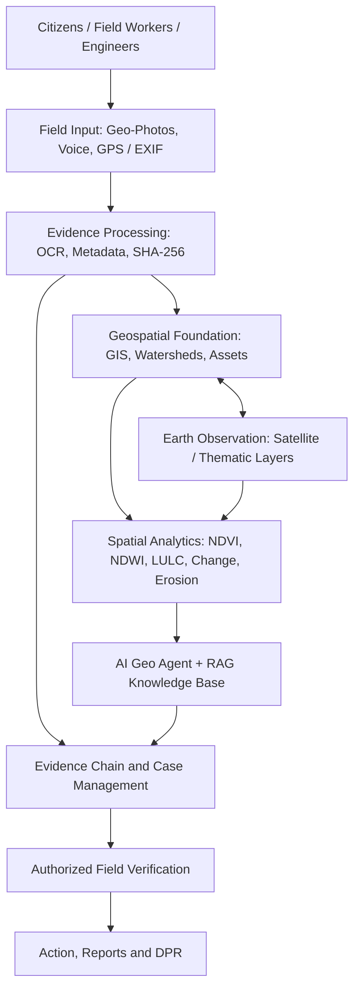

# 🌿 ELIM SPRINGS — Geospatial Watershed Intelligence Platform

**From Field Evidence to Verified Watershed Action**

An evidence-driven geospatial decision-support platform developed for **Smart India Hackathon 2026 — Problem Statement PS-26015**.

ELIM SPRINGS connects real geo-coded field photographs, multilingual voice reports, GIS layers, Earth observation data, and field verification to support watershed assessment and development decisions.

---

## 📖 Project Overview

Watershed development requires more than maps and field reports. Photographs, community observations, satellite-derived indicators, and field measurements need to be interpreted together to understand changing environmental conditions at specific locations.

**ELIM SPRINGS bridges this gap** by connecting field evidence with geospatial context, environmental analysis, and structured case management.

The platform is designed to help citizens, field workers, engineers, and administrators collect evidence, investigate watershed conditions, track cases, and prepare evidence-supported reports.

### 💡 Our Core Idea

**What people report + what field evidence shows + where it happened + what geospatial data indicates + what field verification confirms = better watershed decisions.**

---

## 🎯 Problem Statement

**PS-26015 — Application of Geospatial Techniques for Visualization and Analysis to Interpret Geo-Coded Images to Enhance Watershed Development Outcomes.**

ELIM SPRINGS addresses this challenge by linking geo-coded photographs with satellite observations, watershed boundaries, land-use information, vegetation indicators, water-resource information, drainage networks, and soil or land-degradation assessments.

The objective is to transform field photographs from isolated documentation into spatially linked, traceable analytical evidence that supports watershed development planning and decision-making.

---

## ✨ Key Features

### 🗺️ 1. Geospatial Intelligence

- Interactive GIS maps with watershed and administrative context.
- Geospatial visualization using Leaflet and configured map layers.
- Integration pathway for Indian geospatial resources, including Bhuvan / NRSC.
- Scalable geographical hierarchy: India → State / UT → District → Basin → Watershed → Micro-Watershed → Asset → Evidence.
- Thematic visualization of land, vegetation, water, drainage, and watershed interventions.
- Spatial comparison of observations and environmental indicators.

### 📸 2. Geo-Coded Field Evidence

- Upload real-world field photographs.
- Camera-based image capture where the browser and device permit it.
- EXIF metadata extraction when available.
- GPS coordinates and timestamps recorded when supported by the image or capture workflow.
- OCR-assisted extraction of relevant text from signs and documents.
- SHA-256 evidence integrity hashes.
- Evidence records linked to locations, assets, and cases.

**Evidence integrity:** Original uploaded photographs are preserved as evidence. Missing GPS metadata is not fabricated. AI-assisted interpretations require field verification before operational decisions.

### 🛰️ 3. Earth Observation & Watershed Analysis

- Land-use / land-cover analysis.
- Vegetation-condition indicators such as NDVI.
- Water and moisture-related indicators such as NDWI, where suitable data is available.
- Spatial and temporal comparison of environmental conditions.
- Drainage and water-body visualization.
- Soil erosion and land-degradation risk assessment.
- Visualization of watershed interventions alongside field evidence.
- Support for analysing changes in reservoirs and water bodies across available observation periods.

**Data transparency:** SRISHTI-DRISHTI is a target data source for PS-26015 alignment. Individual satellite services, datasets, and layers should be identified as live integrations, prototype data, or planned integrations according to their actual implementation.

Historical water-level or reservoir comparisons must use dated, traceable observations. Satellite-derived water extent is not the same as a directly measured reservoir water level.

### 🎙️ 4. Multilingual Voice Reporting — 23 Indian Languages

ELIM SPRINGS is designed to make watershed reporting more accessible to citizens and field workers through multilingual interaction, voice reporting, speech processing, and structured field reports.

#### Supported Language Interface

| No. | Language | No. | Language |
|---:|---|---:|---|
| 1 | Assamese | 13 | Manipuri (Meitei) |
| 2 | Bengali | 14 | Marathi |
| 3 | Bodo | 15 | Nepali |
| 4 | Dogri | 16 | Odia |
| 5 | Gujarati | 17 | Punjabi |
| 6 | Hindi | 18 | Sanskrit |
| 7 | Kannada | 19 | Santali |
| 8 | Kashmiri | 20 | Sindhi |
| 9 | Konkani | 21 | Tamil |
| 10 | Maithili | 22 | Telugu |
| 11 | Malayalam | 23 | Urdu |
| 12 | English |  |  |

#### Voice and Language Capabilities

- 🎤 Voice-based field reporting in supported languages.
- 🔄 Speech recognition and language processing through configured services.
- 🇮🇳 Bhashini integration for supported Indian-language services.
- 📝 OCR-assisted extraction of text from field photographs and signboards.
- 📋 Conversion of voice reports into structured watershed observations, where supported.
- 🔊 Text-to-speech assistance for supported languages.
- ↔️ Right-to-left interface support for applicable languages, including Urdu.
- 📍 Linking reports to available location and field evidence.

#### IVR / Voice Reporting Workflow

```text
Select Language
      ↓
Record Voice Report
      ↓
Speech Recognition / ASR
      ↓
Language Processing
      ↓
Structured Field Report
      ↓
Location & Evidence Linking
      ↓
Review and Field Verification
```

The application can use configured browser speech services or connected language APIs, depending on the implementation and service availability.

**Important:** Language availability in the interface does not guarantee that every language has a working live speech-recognition, translation, or text-to-speech service. Actual capabilities depend on the configured integrations and device support.

### 🔎 5. OCR & Evidence Extraction

- Extract text from field photographs and signboards.
- Assist in identifying work codes, scheme information, village names, and other visible text where readable.
- Link extracted information to the corresponding evidence record.
- Support evidence review through structured information.

OCR results may contain recognition errors and should be reviewed before being treated as verified facts.

### 🌱 6. Soil Erosion & Land-Degradation Analysis

- Soil erosion risk assessment using available terrain, land-cover, and environmental information.
- RUSLE-based soil-loss estimation where required factors are available.
- Field measurements for gullies, erosion features, and relevant watershed structures.
- Comparison of model-based risk with geo-coded field evidence.
- Field verification before operational decisions.

The RUSLE model is represented as:

**A = R × K × LS × C × P**

Where:

- **A:** Estimated average soil loss.
- **R:** Rainfall erosivity factor.
- **K:** Soil erodibility factor.
- **LS:** Slope length and steepness factor.
- **C:** Cover-management factor.
- **P:** Support-practice factor.

Estimates depend on the quality, resolution, suitability, and calibration of input data. A single photograph cannot independently determine precise soil loss.

### 🤖 7. AI Geo Agent & RAG Knowledge Assistance

- AI-assisted synthesis of field reports, photographs, GIS context, and environmental indicators.
- Retrieval-Augmented Generation (RAG) for consulting indexed technical documents and watershed guidelines.
- Evidence-linked observations and possible interpretations.
- Recommended field checks for investigating potential issues.
- Support for structured explanations and reporting.
- Human review before verification or action.

The AI Geo Agent assists decision-making; it does not independently establish ground truth or replace field engineers.

### 📋 8. Evidence Chain & Case Management

- Connect reports, photographs, coordinates, OCR output, GIS context, and analysis.
- Maintain traceable evidence records and SHA-256 integrity hashes.
- Create cases from reported watershed issues.
- Track evidence review, field verification, engineering review, and resolution.
- Support report and Detailed Project Report (DPR) preparation.
- Maintain a clear distinction between reported, model-derived, and field-verified findings.

---

## 🏗️ System Architecture

ELIM SPRINGS connects field participation, evidence processing, geospatial analysis, and accountable watershed action through one integrated workflow.



### Architecture Principles

- **Evidence first:** Use real field inputs and preserve original evidence.
- **Spatially connected:** Associate evidence with relevant GIS and watershed context.
- **Multi-source analysis:** Combine field observations with suitable geospatial and Earth observation datasets.
- **AI-assisted interpretation:** Use AI to support analysis, not invent physical observations.
- **Human verification:** Require authorized field verification for operational decisions.
- **Traceability:** Maintain evidence records and integrity hashes throughout the workflow.
- **Modular design:** Keep user interfaces, data services, geospatial processing, AI services, and persistence logically separated.

---

## 🔄 End-to-End Operational Workflow

1. **Report:** A citizen or field worker submits a report or voice observation.
2. **Capture:** A photograph is uploaded or captured through a supported device camera.
3. **Extract:** Available metadata, GPS information, timestamps, and OCR text are processed.
4. **Locate:** Evidence is associated with relevant geospatial and watershed context.
5. **Analyse:** Available Earth observation datasets and GIS layers support spatial interpretation.
6. **Synthesize:** The AI Geo Agent and knowledge base assist with evidence interpretation.
7. **Verify:** An authorized field worker or engineer checks relevant ground conditions.
8. **Act:** A reviewed case can proceed to action, reporting, and DPR preparation.

---

## 🛠️ Technology Stack

| Component | Technology |
|---|---|
| Frontend | React, TypeScript, Vite |
| UI Styling | Tailwind CSS |
| Interactive GIS | Leaflet |
| Application Backend | Laravel, according to the configured application architecture |
| Database | Supabase PostgreSQL |
| File Storage | Supabase Storage |
| Authentication | Supabase Auth, where configured |
| Indian Geospatial Resources | Bhuvan / NRSC, where integrated |
| Earth Observation | SRISHTI-DRISHTI target integration and verified prototype EO sources |
| OCR | Tesseract.js / configured OCR services |
| Voice and Language | Bhashini integration and supported browser speech services |
| AI Assistance | AI Geo Agent and configured LLM services |
| Knowledge Retrieval | RAG-based document retrieval |
| Evidence Integrity | SHA-256 |

*This table describes the reported and intended stack. Verify the repository configuration before treating every listed integration as production-connected.*

---

## 👥 Intended Users

### 👤 Citizens

- Submit local watershed observations.
- Upload photographs and supporting evidence.
- Provide voice-based reports where supported.

### 🥾 Field Workers

- Capture geo-coded evidence.
- Inspect watershed assets.
- Record field measurements.
- Carry out field verification.

### 🏛️ Officers & Engineers

- Review submitted evidence.
- Verify cases and field observations.
- Assign or approve appropriate actions.
- Prepare reports and DPR documentation.

### ⚙️ Administrators

- Manage users and records.
- Monitor reporting and verification workflows.
- Support data management and system oversight.

---

## 🌍 Scalability & Expected Impact

ELIM SPRINGS is designed around a reusable geospatial architecture:

**India → State / UT → District → Basin → Watershed → Micro-Watershed → Asset → Evidence**

### Expected Benefits

- More traceable field monitoring.
- Better integration of ground evidence and Earth observation.
- Improved assessment of watershed interventions.
- Multilingual participation by communities and field teams.
- More structured evidence review and case management.
- A scalable framework for monitoring multiple watersheds.
- Evidence-supported planning and decision-making.

These are intended outcomes, not quantified impact claims. Actual results depend on deployment, dataset coverage, field verification, and evaluation.

---

## 🚀 Installation & Setup

### Prerequisites

- Node.js and npm compatible with the repository.
- Git.
- Access to the required Supabase project.
- Additional backend runtimes required by the actual repository.

### 1. Clone the Repository

```bash
git clone https://github.com/samelijah14122007/elim-springs.git
cd elim-springs
```

### 2. Install Frontend Dependencies

```bash
npm install
```

### 3. Configure Environment Variables

Create a local `.env` file using the variable names documented in `.env.example`, if available.

Configure only the credentials and service URLs required by your implementation.

**Security reminder:** Never commit `.env`, service-role keys, private API keys, passwords, or other secrets to GitHub.

### 4. Start the Development Server

```bash
npm run dev
```

Open the local URL printed by Vite in your terminal.

### 5. Run the Production Build

```bash
npm run build
```

Run any additional backend services using the instructions and scripts present in the repository.

*Installation commands may need adjustment to match the final repository structure.*

---

## 🔗 Project Resources

- **GitHub Repository:** [ELIM SPRINGS](https://github.com/samelijah14122007/elim-springs)
- **Project Demonstration Video:** Add the actual video URL when available.
- **Architecture / Technical Documentation:** Refer to the relevant documentation in this repository.
- **Problem Statement:** PS-26015 — Smart India Hackathon 2026.

---

## 📚 References & Data Sources

- [Smart India Hackathon](https://www.sih.gov.in/)
- [Bhuvan — Indian Geo-Platform](https://bhuvan.nrsc.gov.in/)
- [National Remote Sensing Centre (NRSC)](https://www.nrsc.gov.in/)
- [Bhashini — National Language Technology Mission](https://bhashini.gov.in/)
- [NASA Earthdata](https://www.earthdata.nasa.gov/)
- [Leaflet Documentation](https://leafletjs.com/reference.html)
- [Supabase Documentation](https://supabase.com/docs)
- [Tesseract.js Documentation](https://tesseract.projectnaptha.com/)

Use the applicable official SRISHTI-DRISHTI reference and dataset documentation when confirming the actual data-access pathway.

---

## 🔐 Security & Responsible Use

- Preserve original field evidence.
- Never fabricate image coordinates, measurements, or verification results.
- Use SHA-256 for integrity checking, not as a claim of absolute tamper-proof security.
- Protect credentials and personal information.
- Label prototype datasets and model-generated interpretations clearly.
- Require appropriate human verification before operational decisions.
- Follow the terms and access conditions of external geospatial and language services.

---

## 🤝 Contributions

Contributions, testing, and suggestions that improve the platform's geospatial analysis, accessibility, reliability, and evidence traceability are welcome.

Before contributing, review the repository structure and follow the existing coding conventions.

---


**ELIM SPRINGS — Smart India Hackathon 2026**

*Connecting field voices, geospatial evidence, and watershed development action.*
